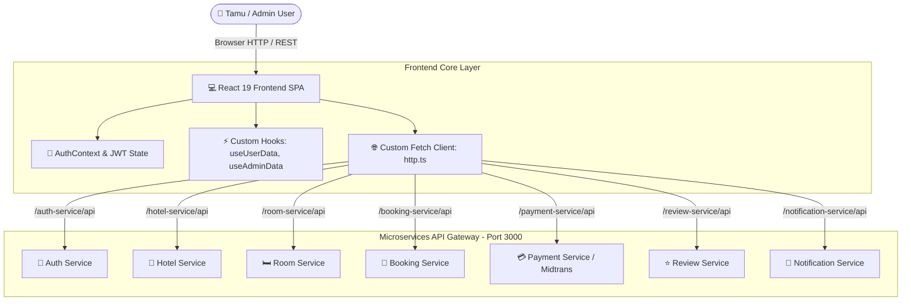

# 🏨 Roomly - Ultra-Luxury Hotel & Resort Booking Dashboard (Frontend)

[](https://react.dev/)
[](https://www.typescriptlang.org/)
[](https://vitejs.dev/)
[](https://tailwindcss.com/)
[]()

> **Dokumentasi Lengkat Enterprise Frontend Roomly** — Platform web reservasi hotel, resor, dan vila kelas dunia yang dibangun dengan **React 19**, **TypeScript 5.8**, dan **Tailwind CSS v4**. Aplikasi ini terintegrasi penuh dengan arsitektur **Microservices API Gateway**, memiliki sistem antarmuka **Clean White Luxury Glassmorphic**, serta 100% responsif dari layar HP mungil (**320px**) hingga monitor ultra-wide (**ASUS TUF / 2K / 4K - 1800px+**).

---

## 📋 Daftar Isi (Table of Contents)

1. [Arsitektur & Gambaran Umum](#-arsitektur--gambaran-umum)
2. [Spesifikasi Tech Stack](#-spesifikasi-tech-stack)
3. [Rincian Fitur Aplikasi](#-rincian-fitur-aplikasi)
   - [Portal Pelanggan (Guest Portal)](#1-portal-pelanggan-guest-portal)
   - [Portal Administrator & Staf (Admin & Staff Portal)](#2-portal-administrator--staf-admin--staff-portal)
4. [Responsivitas Multi-Device (320px hingga 1800px+)](#-responsivitas-multi-device-320px-hingga-1800px)
5. [Pemetaan Microservices API Endpoint](#-pemetaan-microservices-api-endpoint)
6. [Struktur Berkas & Komponen (Directory Sitemap)](#-struktur-berkas--komponen-directory-sitemap)
7. [Manajemen Status & Custom Hooks (State Architecture)](#-manajemen-status--custom-hooks-state-architecture)
8. [Panduan Instalasi & Jalankan Aplikasi](#-panduan-instalasi--jalankan-aplikasi)
9. [Optimasi Performa & Troubleshooting](#-optimasi-performa--troubleshooting)

---

## 🏛️ Arsitektur & Gambaran Umum

Roomly mengadopsi arsitektur **Decoupled Frontend-Microservices Backend**. Frontend React berjalan sebagai *Single Page Application* (SPA) yang berkomunikasi melalui *API Gateway terpadu* di `http://localhost:3000`.

### Diagram Alur Komunikasi Arsitektur (Mermaid)



---

## 🛠️ Spesifikasi Tech Stack

| Kategori | Teknologi | Versi | Fungsi Utama |
| :--- | :--- | :--- | :--- |
| **Core Library** | `react` & `react-dom` | `19.0.1` | Rendering antarmuka berbasis komponen modern. |
| **Build Tool** | `vite` | `6.2.3` | Bundler modul super cepat dengan waktu *Hot Module Replacement* (HMR) < 50ms. |
| **Bahasa** | `typescript` | `5.8.2` | Menjamin ketersediaan tipe data (*Strict Type Safety*) tanpa error kompilasi. |
| **Router** | `react-router-dom` | `7.18.2` | Navigasi halaman SPA (*Client-side Routing*). |
| **Styling Engine** | `tailwindcss` | `4.1.14` | Styling utility-first modern dengan integrasi `@tailwindcss/vite`. |
| **Animasi** | `motion` (Framer Motion) | `12.23.24` | Animasi transisi halaman, efek modal, & indikator mikro. |
| **Visualisasi Data**| `recharts` | `3.10.1` | Grafik interaktif tren pengeluaran bulanan & peta distribusi penginapan. |
| **Set Ikon** | `lucide-react` | `0.546.0` | 500+ ikon vektor SVG beresolusi tinggi. |
| **AI Integration** | `@google/genai` | `2.4.0` | Kebutuhan integrasi fitur asisten cerdas Gemini AI. |

---

## ✨ Rincian Fitur Aplikasi

### 1. Portal Pelanggan (Guest Portal)

#### A. Beranda Interaktif (HomePage - `/`)
* **Hero Search Widget**: Pencarian hotel berdasarkan nama kota, rentang tanggal check-in/out, dan jumlah tamu (dewasa & anak-anak).
* **Mitra Hotel Terpilih**: Kapsul bertema *Clean White Luxury* yang menampilkan brand hotel ternama (*Swiss-Belhotel, ARTOTEL, Santika, AYANA, d'prima*).
* **Destinasi Populer**: Kartu visual kota tujuan utama (*Bali, Jakarta, Bandung, Yogyakarta, Singapore, Tokyo*).
* **Rekomendasi Hotel Terbaik**: Grid hotel berbintang dengan indikator rating dan fasilitas utama.

#### B. Halaman Jelajahi & Filter (Explore - `/explore`)
* **Filtering Tingkat Lanjut**: Filter berdasarkan kata kunci kota, jumlah bintang (1-5 Bintang), kisaran harga per malam (IDR), serta fasilitas pilihan (*Kolam Renang, WiFi, Spa, Pusat Kebugaran, Restoran*).
* **Pengurutan Fleksibel**: Urutkan berdasarkan *Rekomendasi, Rating Tertinggi, Harga Terendah, atau Harga Tertinggi*.

#### C. Detail Kamar & Reservasi Instan (`/rooms/:hotelId/:roomId`)
* **Galeri Foto Interaktif**: Viewer gambar utama dengan navigasi slide thumbnail.
* **Spesifikasi Lengkap**: Luas kamar (m²), tipe tempat tidur (*King/Twin*), kapasitas dewasa/anak, dan daftar amenitas terinci per area (*Kamar Mandi, Kamar Tidur, Hiburan*).
* **Kartu Harga & Status Ketersediaan**: Tampilan harga per malam dengan responsivitas teks *auto-fit*, badge diskon, serta indikator stok sisa unit hari ini.
* **Modal Pemesanan Direct Midtrans**: Tombol *Pesan Sekarang* untuk langsung generate token pembayaran Midtrans Snap.

#### D. Reservasi Saya & Invoice Digital (`/bookings`)
* **Filter Status Reservasi**: Tab navigasi untuk memilah transaksi (*Menunggu Pembayaran, Aktif/Konfirmasi, Selesai, Dibatalkan*).
* **Pratinjau Kode Booking**: Informasi kode unik reservasi, tanggal check-in/out, dan status kamar.
* **Modal Invoice Digital**: Tampilan rincian biaya lengkap, pajak, biaya layanan, dan opsi cetak/download invoice PDF.

#### E. Analitik Perjalanan (Analytics - `/analytics`)
* **Ringkasan Pengeluaran (KPI)**: Total pengeluaran (IDR), rata-rata tarif per malam, jumlah malam diinapi, dan transaksi pending.
* **Grafik Tren Belanja Bulanan**: *Area Chart* Recharts yang memperlihatkan histori grafik belanja perjalanan per bulan.
* **Distribusi Lokasi Inap**: *Pie Chart* Recharts yang menampilkan persentase favorit kota/hotel yang sering dikunjungi.

#### F. Pusat Notifikasi & Preferensi Akun (`/settings`)
* **Pusat Notifikasi Global**: Lonceng notifikasi pada header dengan badge merah belum dibaca, mendukung penandaan *Mark as Read* otomatis.
* **Preferensi Notifikasi Multi-Channel**: Sakelar (*Toggle Switch*) untuk mengaktifkan/mematikan notifikasi kategori *Reservasi, Pembayaran, Promosi, & Keamanan* pada channel **In-App** maupun **Email**.
* **Dukungan Dua Bahasa (Bilingual)**: Alih bahasa satu klik antara **Bahasa Indonesia (ID)** dan **English (EN)**.

---

### 2. Portal Administrator & Staf (Admin & Staff Portal)

#### A. Dasbor Utama Administrator (`/admin`)
* **Statistik Pendapatan Real-Time**: Total omset gross kotor (IDR), persentase hunian kamar (*Occupancy Rate*), jumlah kamar aktif terisi, dan total reservasi masuk.
* **Manajemen Akun Staf**: Pembuatan akun staf baru (Role ADMIN/STAFF) dan sakelar nonaktifkan akun staf.
* **Tabel Reservasi Terpusat**: Monitoring reservasi dari seluruh cabang hotel secara real-time.

#### B. Terminal Check-In Staf (`/staff/check-in`)
* **Pencarian Kode Reservasi**: Staf resepsionis dapat memasukkan kode booking tamu saat kedatangan.
* **Penetapan Nomor Unit Kamar**: Memilih unit kamar kosong (*Status AVAILABLE*) dan melakukan konfirmasi proses check-in secara instan.

#### C. Kelola Katalog Hotel & Kamar (`/admin/hotels`)
* Operasi CRUD untuk menambah hotel baru, mengubah tipe kamar, mengunggah foto galeri, dan menetapkan tarif spesial musim liburan (*Special Pricing*).

#### D. Direktori Akun Pelanggan (`/admin/customers`)
* Ringkasan daftar pengguna terdaftar, total transaksi reservasi yang pernah dibuat, dan tanggal bergabung.

#### E. Gateway Pembayaran & Master Data (`/admin/payments` & `/admin/master-data`)
* Laporan histori transaksi Midtrans dan pengelolaan master data fasilitas serta aturan pembatalan hotel.

---

## 📱 Responsivitas Multi-Device (320px hingga 1800px+)

Pengembangan antarmuka Roomly mematuhi standar ketat **Mobile-First & Ultra-Wide Widescreen Optimization**:

```text
  +-------------------------------------------------------------------------------+
  |  Layar HP Super Sempit (320px - 480px)                                        |
  |  - Header ringkas: Logo 'R' (w-7 h-7), tombol Masuk (px-2.5 py-1.5 text-11px)|
  |  - Hamburger Menu (≡) 100% selalu tampak & terjangkau ibu jari                |
  |  - Harga IDR besar mengadopsi font auto-scale (text-2xl sm:text-4xl)          |
  +-------------------------------------------------------------------------------+
                                         |
                                         v
  +-------------------------------------------------------------------------------+
  |  Layar Laptop & Desktop Standard (1024px - 1440px)                            |
  |  - Navigasi menu pill desktop aktif                                          |
  |  - Layout 2 kolom (Konten Kiri + Sticky Booking Card Kanan)                  |
  +-------------------------------------------------------------------------------+
                                         |
                                         v
  +-------------------------------------------------------------------------------+
  |  Layar Lebar & Monitor Gaming (ASUS TUF / 2K / 4K - 1800px+)                  |
  |  - Kontainer membentang hingga max-w-[1800px] 2xl:px-16                        |
  |  - Grid hotel otomatis beralih ke 5 Kolom (2xl:grid-cols-5)                  |
  +-------------------------------------------------------------------------------+
```

---

## 🔌 Pemetaan Microservices API Endpoint

Seluruh panggilan API dikelola oleh modul client `src/lib/http.ts` yang menangani penambahan token `Authorization: Bearer <token>` secara otomatis:

### 1. Authentication Service (`/auth-service/api/auth`)
- `POST /login` - Otentikasi pengguna & pengembalian token JWT.
- `POST /register` - Pendaftaran akun pelanggan baru.
- `GET /me` - Verifikasi sesi token pengguna saat ini.
- `POST /logout` - Pengakhiran sesi otentikasi.

### 2. Hotel Service (`/hotel-service/api/hotels`)
- `GET /` - Mengambil katalog seluruh hotel.
- `GET /:id` - Mengambil detail spesifik hotel.
- `GET /search` - Pencarian hotel berdasarkan parameter kota/rating.

### 3. Room Service (`/room-service/api/rooms`)
- `GET /?hotelId=:id` - Mengambil daftar kamar per hotel.
- `GET /:roomId` - Detail kamar & amenitas.
- `GET /:roomId/images` - Galeri foto kamar.
- `GET /:roomId/units` - Daftar unit kamar fisik & status stok.

### 4. Booking Service (`/booking-service/api/bookings`)
- `GET /my-bookings` - Riwayat pemesanan milik pelanggan yang sedang login.
- `POST /` - Membuat reservasi kamar baru.
- `GET /code/:bookingCode` - Pencarian reservasi via kode booking (Terminal Check-In).
- `POST /:id/check-in` - Konfirmasi check-in tamu & alokasi nomor kamar.

### 5. Payment Service (`/payment-service/api/payments`)
- `POST /snap-token` - Generate token pembayaran Midtrans Snap.
- `GET /:bookingId/status` - Verifikasi status transaksi Midtrans.

### 6. Notification Service (`/notification-service/api/notifications`)
- `GET /?page=0&size=30` - Mengambil daftar notifikasi in-app pengguna.
- `POST /:id/read` - Memperbarui status notifikasi menjadi terbaca.
- `GET /preferences` - Mengambil preferensi channel notifikasi pengguna.
- `PUT /preferences` - Memperbarui preferensi channel notifikasi.

---

## 📂 Struktur Berkas & Komponen (Directory Sitemap)

```text
src/
├── api/                        # Modul panggilan HTTP API per domain service
│   ├── admin.ts                # API statistik admin, kelola staf, & check-in
│   ├── auth.ts                 # API login, register, & get me
│   ├── bookings.ts             # API pemesanan kamar & cari kode booking
│   ├── hotels.ts               # API katalog hotel & pencarian
│   ├── invoices.ts             # API pratinjau & unduh invoice
│   ├── notifications.ts        # API notifikasi & preferensi channel
│   ├── payments.ts             # API gateway pembayaran Midtrans
│   ├── reviews.ts              # API ulasan & rating hotel
│   ├── rooms.ts                # API detail kamar & unit ketersediaan
│   └── wishlist.ts             # API daftar favorit hotel
├── components/                 # Modul komponen antarmuka reusable
│   ├── admin/                  # Komponen khusus panel administrator
│   │   ├── AdminBookingsTable.tsx
│   │   ├── AdminCustomersTable.tsx
│   │   ├── AdminStatsGrid.tsx
│   │   └── StaffModal.tsx
│   ├── explore/                # Komponen halaman jelajahi
│   │   ├── ExploreFilters.tsx
│   │   ├── ExploreHero.tsx
│   │   └── ExploreResults.tsx
│   ├── home/                   # Komponen halaman beranda
│   │   ├── ActiveBookingBanner.tsx
│   │   ├── HeroSection.tsx
│   │   ├── NewsletterCTA.tsx
│   │   ├── PopularDestinations.tsx
│   │   └── WhyChooseUsSection.tsx
│   ├── layout/                 # Layout utama & navigasi header
│   │   ├── Header.tsx          # Sticky navbar utama (bg-white solid)
│   │   ├── HeaderLogo.tsx      # Logo Roomly responsif
│   │   ├── HeaderMobileNav.tsx # Drawer menu mobile (dengan kartu profil & logout)
│   │   ├── HeaderNotifications.tsx
│   │   ├── HeaderSearchDropdown.tsx
│   │   ├── HeaderTopBar.tsx    # Bar utility paling atas
│   │   └── HeaderUserMenu.tsx  # Avatar profil & tombol masuk
│   ├── rooms/                  # Komponen detail kamar & galeri
│   │   ├── RoomDetailGrid.tsx
│   │   └── RoomGallery.tsx
│   └── ui/                     # UI Primitives & Modals
│       ├── AuthModal.tsx
│       ├── InvoiceModal.tsx
│       └── ToastContainer.tsx
├── context/
│   └── AuthContext.tsx         # Provider status otentikasi & manajemen token JWT
├── hooks/
│   ├── useAdminData.ts         # Hook penanganan data dasbor admin
│   └── useUserData.ts          # Hook penanganan data notifikasi & reservasi user
├── lib/
│   ├── adapters.ts             # Pengubah skema data DTO API ke UI Client
│   ├── http.ts                 # Custom fetch wrapper dengan penanganan 401/404
│   ├── notificationFormatter.ts# Formatter pesan notifikasi
│   ├── routes.ts               # Definisi konstanta rute navigasi
│   └── utils.ts                # Helper format mata uang IDR & tanggal
├── pages/                      # Halaman utama aplikasi (View Pages)
│   ├── AdminDashboardPage.tsx  # Dasbor utama administrator
│   ├── AdminHotelsPage.tsx     # Manajemen katalog hotel admin
│   ├── AdminInvoicesPage.tsx   # Kelola invoice admin
│   ├── AdminMasterDataPage.tsx # Master data fasilitas & kebijakan
│   ├── AdminNotificationsPage.tsx
│   ├── AdminPaymentsPage.tsx   # Monitoring gateway pembayaran
│   ├── AdminReviewsPage.tsx    # Kelola ulasan pelanggan
│   ├── AnalyticsPage.tsx       # Analitik pengeluaran pelanggan
│   ├── BookingCheckoutPage.tsx # Halaman checkout reservasi
│   ├── BookingsPage.tsx        # Halaman reservasi pelanggan
│   ├── CheckInPage.tsx         # Terminal check-in staf
│   ├── ExplorePage.tsx         # Halaman pencarian hotel
│   ├── HomePage.tsx            # Halaman beranda utama
│   ├── RoomDetailPage.tsx      # Halaman detail kamar
│   ├── SettingsPage.tsx        # Halaman profil & preferensi notifikasi
│   └── WishlistPage.tsx        # Halaman daftar favorit
├── types/                      # Definisi tipe TypeScript
│   ├── api/                    # DTO Antarmuka backend Microservices
│   └── index.ts                # Tipe data internal antarmuka UI
├── App.tsx                     # Component root & penanganan rute terpusat
└── main.tsx                    # File titik masuk aplikasi React
```

---

## ⚡ Manajemen Status & Custom Hooks (State Architecture)

### 1. `AuthContext.tsx`
* Mengelola status autentikasi pengguna secara global (`user`, `token`, `loading`).
* Memeriksa keberadaan token JWT di `localStorage` saat inisialisasi aplikasi via `GET /auth-service/api/auth/me`.
* Menyediakan fungsi `login()`, `register()`, dan `logout()` yang otomatis membersihkan token dan menyegarkan sesi.

### 2. `useUserData.ts`
* Mengelola data khusus pengguna yang sedang login (daftar pemesanan & notifikasi).
* Dilengkapi penanganan toleransi kesalahan (*Graceful Degradation*): Jika service notifikasi belum aktif (`404 Not Found`), sistem akan mengabaikannya tanpa membuat halaman *crash*.

### 3. `useAdminData.ts`
* Digunakan khusus pada panel administrator (`/admin`).
* Melakukan pemanggilan data agregat secara paralel (`stats`, `allBookings`, `staffList`) serta menyediakan handler operasi *Create Staff*, *Deactivate Staff*, dan *Guest Check-Out*.

---

## 💻 Panduan Instalasi & Jalankan Aplikasi

### Prasyarat Perangkat Lunak:
* **Node.js**: Versi `18.x` atau `20.x`
* **npm**: Versi `9.x` atau `10.x`

### Langkah-Langkah Inisialisasi:

1. **Buka Terminal & Masuk ke Direktori Proyek**:
   ```bash
   cd "C:\DATA FAJAR\PROJECT\hotel-booking-dashboard"
   ```

2. **Instal Seluruh Dependensi**:
   ```bash
   npm install
   ```

3. **Jalankan Server Pengembang (Development Mode)**:
   ```bash
   npm run dev
   ```
   Aplikasi akan aktif dan dapat diakses melalui browser pada URL:
   👉 **`http://localhost:3000`**

4. **Jalankan Pengecekan Tipe TypeScript (Linting)**:
   ```bash
   npm run lint
   ```
   *Memastikan seluruh kode 100% bebas dari kesalahan tipe data.*

5. **Build untuk Lingkungan Produksi (Production Build)**:
   ```bash
   npm run build
   ```
   *Berkas hasil build yang telah dioptimasi dan diminifikasi akan tersimpan di direktori `dist/`.*

---

## 🛠️ Optimasi Performa & Troubleshooting

### 1. Eliminasi Scroll Stutter (Kinerja Rendering Mulus 60 FPS)
* **Solusi**: Mengganti efek blur semi-transparan `bg-white/98 backdrop-blur-md` pada header sticky dengan warna **solid pure white (`bg-white`)**. Hal ini menghilangkan beban GPU compositor saat membaca piksel di belakang header saat melakukan scroll cepat.

### 2. Penanganan Error 401 Unauthorized Saat Belum Login
* **Solusi**: Pada komponen `AuthContext.tsx`, jika request `GET /auth/me` mengembalikan status `401 Unauthorized` karena pengguna belum melakukan login, error ini akan ditangkap secara senyap tanpa menampilkan alert merah di konsol browser.

### 3. Penanganan Error 404 Notification Service Fallback
* **Solusi**: Jika microservice notifikasi belum siap atau mengembalikan `404 Not Found`, `useUserData.ts` menangkap exception tersebut dan menyajikan *empty array* `[]` sehingga antarmuka pengguna tetap berjalan lancar.

---

## 📄 Lisensi & Hak Cipta

© 2026 **Roomly Hotel & Resort Dashboard Team**. Seluruh Hak Cipta Dilindungi Undang-Undang.
